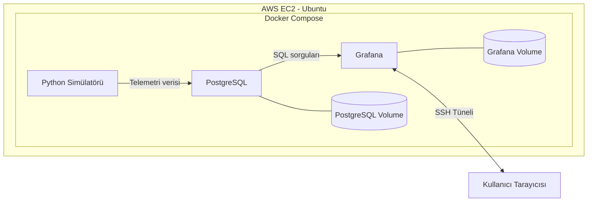

# Bulut Tabanlı İHA Telemetri İzleme ve Kayıt Sistemi

## 1. Proje Hakkında

Bu proje, Kocaeli Üniversitesi Bilişim Sistemleri Mühendisliği Bölümü, Bulut Bilişimde Sanallaştırma Teknolojilerine Giriş dersi kapsamında geliştirilmiştir.

Projenin amacı, insansız hava araçlarından (İHA) elde edilebilecek telemetri verilerinin bulut ortamında toplanması, saklanması ve görselleştirilmesidir.

Gerçek bir İHA yerine Python ile geliştirilen bir simülatör kullanılmaktadır. Simülatör tarafından üretilen veriler PostgreSQL veritabanına kaydedilmekte ve Grafana üzerinden izlenmektedir.

Sistem, AWS EC2 sanal sunucusu üzerinde Docker Compose kullanılarak çalıştırılmaktadır.

## 2. Projenin Özellikleri

- Saniyede yaklaşık bir telemetri verisi üretimi
- GPS koordinatlarının simülasyonu
- Anlık hız ve irtifa takibi
- Batarya seviyesinin izlenmesi
- Düşük batarya uyarısı
- PostgreSQL ile kalıcı veri depolama
- Grafana ile dinamik veri görselleştirme
- Harita üzerinde İHA konumunun gösterilmesi
- Docker ile konteyner tabanlı uygulama dağıtımı
- AWS EC2 üzerinde bulut tabanlı çalışma
- SSH tüneli üzerinden güvenli uzaktan erişim

## 3. Kullanılan Teknolojiler

| Teknoloji | Kullanım amacı |
|---|---|
| Python 3.10 | Telemetri verilerinin üretilmesi |
| PostgreSQL 15 | Telemetri verilerinin saklanması |
| Psycopg | Python ve PostgreSQL bağlantısı |
| Grafana 12.3.0 | Verilerin görselleştirilmesi |
| Docker | Uygulama bileşenlerinin konteynerleştirilmesi |
| Docker Compose | Konteynerlerin birlikte yönetilmesi |
| AWS EC2 | Bulut tabanlı sanal sunucu |
| Ubuntu | Bulut sunucusunun işletim sistemi |
| Git ve GitHub | Sürüm kontrolü |
| VS Code | Yazılım geliştirme ortamı |

## 4. Sistem Mimarisi

Sistem üç temel konteynerden oluşmaktadır:

1. Python simülatörü
2. PostgreSQL veritabanı
3. Grafana görselleştirme servisi



Python simülatörü telemetri verilerini üretir ve PostgreSQL veritabanına kaydeder. Grafana, PostgreSQL üzerinden sorguladığı verileri kullanıcıya sunar.

Docker volume alanları sayesinde konteynerler yeniden oluşturulduğunda verilerin korunması sağlanır.

## 5. Telemetri Verileri

| Alan | Açıklama |
|---|---|
| id | Benzersiz kayıt numarası |
| drone_id | İHA kimlik numarası |
| timestamp | Verinin üretildiği zaman |
| latitude | Enlem |
| longitude | Boylam |
| speed | Hız (km/sa) |
| altitude | İrtifa (metre) |
| battery | Batarya seviyesi (%) |

## 6. Proje Klasör Yapısı

```
iha-telemetri-bulut/
├── database/
│   └── init.sql
├── docs/
│   └── test-results.md
├── grafana/
│   ├── dashboard.json
│   └── provisioning/
│       ├── dashboards/
│       │   └── dashboard.yaml
│       └── datasources/
│           └── datasource.yaml
├── simulator/
│   ├── main.py
│   └── veritabani.py
├── .dockerignore
├── .gitignore
├── compose.yaml
├── Dockerfile
├── requirements.txt
└── README.md
```

## 7. Kurulum ve Çalıştırma

### 7.1. Gereksinimler

- Git
- Docker
- Docker Compose

### 7.2. Projenin İndirilmesi

```bash
git clone https://github.com/meryemozubek/iha-telemetri-bulut.git
cd iha-telemetri-bulut
```

### 7.3. Ortam Değişkenlerinin Ayarlanması

Projenin ana dizininde `.env` isimli bir dosya oluşturulmalıdır.

```env
POSTGRES_PASSWORD=guclu_bir_sifre_belirleyin
```

Güvenlik nedeniyle gerçek veritabanı şifresi GitHub üzerinde paylaşılmamaktadır. `.env` dosyası Git tarafından takip edilmemektedir.

### 7.4. Konteynerlerin Başlatılması

```bash
docker compose up -d --build
```

Konteynerlerin durumunu kontrol etmek için:

```bash
docker compose ps -a
```

Simülatör loglarını görüntülemek için:

```bash
docker compose logs -f simulator
```

Linux ortamında gerekli kullanıcı izinleri bulunmuyorsa Docker komutları `sudo` ile çalıştırılmalıdır.

## 8. Grafana İzleme Paneli

Yerel ortamda Grafana paneline aşağıdaki adres üzerinden erişilebilir:

http://localhost:3000

Grafana izleme paneli dört temel bölümden oluşmaktadır:

- Batarya seviyesi göstergesi
- GPS konum haritası
- İrtifa grafiği
- Hız grafiği

Veri kaynağı ve dashboard yapılandırmaları Grafana provisioning mekanizması ile otomatik olarak yüklenmektedir.

## 9. AWS Bulut Ortamında Çalıştırma

Proje aşağıdaki özelliklere sahip bir AWS EC2 sanal sunucusu üzerinde çalıştırılmıştır:

| Özellik | Değer |
|---|---|
| Bölge | Stockholm (eu-north-1) |
| Sunucu tipi | t3.small |
| İşlemci | 2 vCPU |
| RAM | 2 GiB |
| İşletim sistemi | Ubuntu 26.04.1 LTS |

Sunucuya SSH üzerinden bağlanılmış ve proje Docker Compose kullanılarak çalıştırılmıştır.

PostgreSQL ve Grafana servisleri doğrudan internete açılmamıştır. Grafana erişimi SSH tüneli üzerinden gerçekleştirilmiştir.

SSH tüneli oluşturmak için:

```bash
ssh -i "anahtar.pem" -N -L 3001:127.0.0.1:3000 ubuntu@SUNUCU_ADRESI
```

Tünel oluşturulduktan sonra Grafana paneline aşağıdaki adres üzerinden erişilebilir:

http://localhost:3001

Burada 3001 yerel bilgisayarın portunu, 3000 ise AWS sunucusunda çalışan Grafana servisinin portunu ifade etmektedir.

## 10. Simülatörün Çalışma Mantığı

Simülatör, GPS koordinatları, hız, irtifa ve batarya seviyesini belirli sınırlar içerisinde değiştirerek telemetri verisi üretmektedir.

Her döngüde oluşturulan veri PostgreSQL veritabanına kaydedilmektedir. Batarya seviyesi %20'nin altına düştüğünde düşük batarya uyarısı oluşturulmaktadır.

Batarya seviyesi sıfıra ulaştığında simülasyon sona ermektedir.

Yeni bir uçuş başlatmak için:

```bash
docker compose start simulator
```

## 11. Performans ve Test Sonuçları

AWS EC2 üzerinde işlevsel sistem testleri, kaynak tüketimi testleri, veri kayıt performansı ve veri kalıcılığı testleri gerçekleştirilmiştir.

| Ölçülen özellik | Sonuç |
|---|---:|
| Ortalama toplam konteyner CPU tüketimi | %0.462 |
| Ortalama toplam konteyner RAM tüketimi | 342.15 MiB |
| 60 saniyede kaydedilen veri sayısı | 60 |
| Hedef kayıt hızına ulaşma oranı | %100 |
| Ortalama kayıt aralığı | 1.0169 saniye |
| Kalıcılık testi öncesi kayıt sayısı | 1233 |
| Kalıcılık testi sonrası kayıt sayısı | 1233 |
| Kayıt sayısının korunma oranı | %100 |

Bu sonuçlar kısa süreli ve tek İHA simülasyonu altında elde edilmiştir.

Ayrıntılı deney yöntemleri, ölçüm sonuçları ve test sınırlılıkları için [Test Sonuçları](docs/test-results.md) dosyası incelenebilir.

## 12. Sistemin Durdurulması

Konteynerleri geçici olarak durdurmak için:

```bash
docker compose stop
```

Konteynerleri ve Docker ağını kaldırmak için:

```bash
docker compose down
```

Verilerin korunması için Docker volume alanları silinmemelidir. `docker compose down -v` komutu kalıcı verilerin silinmesine neden olabilir.

## 13. Gelecekte Yapılabilecek Geliştirmeler

- Birden fazla İHA'nın eş zamanlı izlenmesi
- Gerçek İHA telemetri verilerinin sisteme aktarılması
- HTTP API veya MQTT entegrasyonu
- Otomatik bildirim ve alarm mekanizmaları
- Güvenli kapanma mekanizmasının geliştirilmesi
- Uzun süreli performans ve yük testleri
- Otomatik veritabanı yedekleme sistemi

## 14. Proje Bilgileri

- Geliştirici: Meryem Özübek
- Üniversite: Kocaeli Üniversitesi
- Bölüm: Bilişim Sistemleri Mühendisliği
- Ders: Bulut Bilişimde Sanallaştırma Teknolojilerine Giriş
- Akademik yıl: 2026-2027

Bu proje eğitim ve araştırma amacıyla geliştirilmiştir.