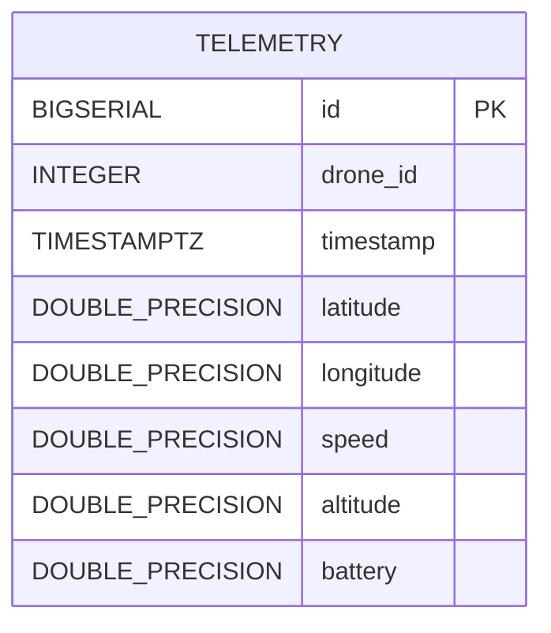

# Veritabanı ER Diyagramı

## Veritabanı Tasarımı

Sistemde telemetri verilerinin saklanması için PostgreSQL
ilişkisel veritabanı yönetim sistemi kullanılmaktadır.

Python simülatörü tarafından üretilen bütün telemetri
verileri telemetry isimli tabloda saklanmaktadır.

## Tablo Alanları

| Alan | Veri tipi | Açıklama |
|---|---|---|
| id | BIGSERIAL | Otomatik artan benzersiz kayıt numarası |
| drone_id | INTEGER | İHA kimlik numarası |
| timestamp | TIMESTAMPTZ | Zaman dilimi bilgisine duyarlı zaman damgası |
| latitude | DOUBLE PRECISION | Enlem bilgisi |
| longitude | DOUBLE PRECISION | Boylam bilgisi |
| speed | DOUBLE PRECISION | Hız (km/sa) |
| altitude | DOUBLE PRECISION | İrtifa (metre) |
| battery | DOUBLE PRECISION | Batarya seviyesi (%) |

## Veritabanı Kısıtlamaları

- id alanı birincil anahtar (Primary Key) olarak tanımlanmıştır.
- id alanı otomatik olarak artmaktadır.
- Bütün alanlar NOT NULL kısıtlamasına sahiptir.
- drone_id alanı İHA kimliğini belirtmektedir.
- Sistemde tek tablo bulunduğundan yabancı anahtar
  (Foreign Key) kullanılmamaktadır.

## Verilerin Kalıcılığı

PostgreSQL verileri Docker volume içerisinde saklanmaktadır.

Konteynerler kaldırılıp yeniden oluşturulduğunda volume
silinmediği sürece veriler korunmaktadır.

Veri kalıcılığı testinde konteynerler yeniden oluşturulmadan
önce ve sonra 1233 kayıt bulunduğu doğrulanmıştır.

## Gelecekteki Geliştirmeler

Sistemin kapsamı genişletildiğinde İHA bilgilerinin
saklanması için ayrı bir drones tablosu oluşturulabilir.

Bu durumda telemetry tablosundaki drone_id alanı
yabancı anahtar olarak tanımlanabilir.