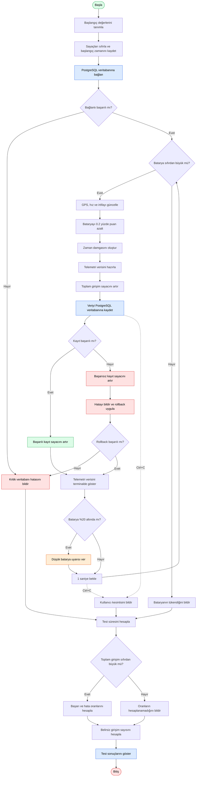

# Simülatör Akış Diyagramı

## Akış Diyagramı (Flowchart)

## 1. Algoritmanın Açıklaması

Simülatör başlatıldığında İHA'nın başlangıç değerleri,
performans sayaçları ve test başlangıç zamanı belirlenir.

PostgreSQL veritabanına bir kez bağlantı oluşturulur.

Batarya seviyesi sıfırdan büyük olduğu sürece
telemetri üretimi devam eder.

Her döngüde GPS koordinatları, hız ve irtifa
değerleri güncellenir. Batarya seviyesi 0.2 yüzde
puan azaltılır ve zaman damgası oluşturulur.

Hazırlanan telemetri verisi PostgreSQL veritabanına
kaydedilmeden önce toplam girişim sayacı artırılır.

Kayıt başarılı olduğunda başarılı kayıt sayacı artırılır.

Kayıt sırasında PostgreSQL hatası oluştuğunda
başarısız kayıt sayacı artırılır, hata terminalde
gösterilir ve rollback işlemi uygulanır.

Rollback başarılı olduğunda simülatör çalışmaya
devam eder.

Üretilen telemetri bilgileri terminalde gösterilir.
Batarya seviyesi %20'nin altındaysa düşük batarya
uyarısı verilir.

Her döngünün sonunda bir saniye beklenir ve
batarya seviyesi yeniden kontrol edilir.

## 2. Sonlandırma Koşulları

Simülasyon aşağıdaki durumlarda sona erebilir:

- Bataryanın tamamen tükenmesi.
- Kullanıcının Ctrl+C ile programı durdurması.
- Kritik veritabanı bağlantı veya işlem hatası.

Programın finally bloğunda test sonuçları
hesaplanarak terminalde gösterilir.

Kritik veritabanı hatası oluştuğunda hata yeniden
yükseltilir ve program hata ile sonlanır.

## 3. Sözde Kod (Pseudocode)

    BAŞLA

    Başlangıç telemetri değerlerini tanımla

    Toplam girişim = 0
    Başarılı kayıt = 0
    Başarısız kayıt = 0

    Başlangıç zamanını kaydet

    DENE:

        PostgreSQL veritabanına bağlan

        Batarya > 0 olduğu sürece:

            GPS koordinatlarını güncelle

            Hız değerini güncelle
            Hızı 0-80 km/sa arasında sınırla

            İrtifa değerini güncelle
            İrtifayı 0-150 metre arasında sınırla

            Batarya seviyesini 0.2 azalt
            Bataryanın negatif olmasını engelle

            Zaman damgasını oluştur
            Telemetri verisini hazırla

            Toplam girişimi 1 artır

            DENE:

                Veriyi PostgreSQL'e kaydet
                Başarılı kayıt sayısını 1 artır

            VERİTABANI KAYIT HATASI OLUŞURSA:

                Başarısız kayıt sayısını 1 artır
                Hata mesajını göster
                Rollback işlemini uygula

            Telemetri verilerini terminalde göster

            Eğer batarya seviyesi 20'nin altındaysa:
                Düşük batarya uyarısı ver

            1 saniye bekle

        Bataryanın tükendiğini bildir

    KULLANICI KESİNTİSİ OLUŞURSA:

        Simülasyonun durdurulduğunu bildir

    KRİTİK VERİTABANI HATASI OLUŞURSA:

        Hata mesajını göster
        Hatayı yeniden yükselt

    HER DURUMDA (FINALLY):

        Test süresini hesapla

        Eğer toplam girişim > 0 ise:

            Başarı oranı =
                (Başarılı kayıt / Toplam girişim) x 100

            Hata oranı =
                (Başarısız kayıt / Toplam girişim) x 100

        Değilse:

            Oranların hesaplanamadığını bildir

        Belirsiz girişim =
            Toplam girişim -
            Başarılı kayıt -
            Başarısız kayıt

        Test sonuçlarını terminalde göster

    BİTİR

## 4. Kontrollü Hata Testi

simulator/hata_testi.py dosyası, normal telemetri
üretim fonksiyonunu test amacıyla değiştirmektedir.

Her beşinci telemetri kaydında drone_id alanına
None değeri atanır.

PostgreSQL NOT NULL kısıtı nedeniyle bu kayıt
reddedilir.

Hata yönetimi ve rollback mekanizması sayesinde
sonraki geçerli kayıtların işlenmesi sağlanır.

## 5. Diyagramın Kapsamı

Akış diyagramı simulator/main.py ve
simulator/hata_testi.py dosyalarının güncel çalışma
mantığı temel alınarak hazırlanmıştır.

Ctrl+C kesintisi farklı çalışma aşamalarında
oluşabilir. Okunabilirlik amacıyla diyagramda
kayıt ve bekleme aşamalarında gösterilmiştir.

Sistemde otomatik yeniden bağlanma mekanizması
bulunmamaktadır.
