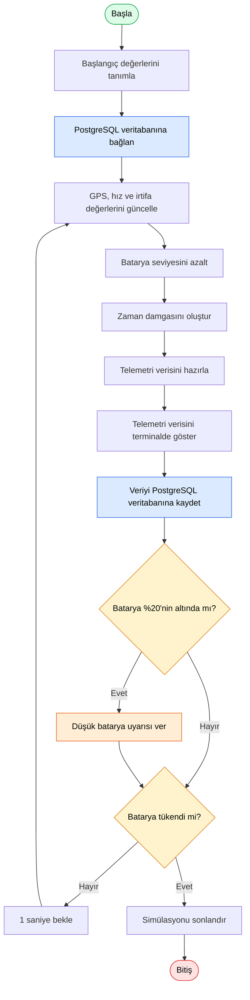

# Simülatör Akış Diyagramı

## Algoritmanın Açıklaması

Simülatör başlatıldığında İHA'nın başlangıç değerleri
tanımlanır ve PostgreSQL veritabanına bağlantı sağlanır.

Her döngüde GPS koordinatları, hız ve irtifa değerleri
belirlenen sınırlar içerisinde güncellenir.

Batarya seviyesi her döngüde 0.2 yüzde puan azaltılır.
Oluşturulan telemetri verisine zaman damgası eklenir
ve veri PostgreSQL veritabanına kaydedilir.

Batarya seviyesi %20'nin altına düştüğünde düşük
batarya uyarısı oluşturulur.

Batarya tamamen tükenmediği sürece simülatör yaklaşık
bir saniyelik aralıklarla veri üretmeye devam eder.

Batarya seviyesi sıfıra ulaştığında simülasyon sonlandırılır.

## Sözde Kod (Pseudocode)

    BAŞLA

    Başlangıç değerlerini tanımla
    Veritabanına bağlan

    Batarya tükenmediği sürece:

        GPS koordinatlarını güncelle
        Hız değerini güncelle
        İrtifa değerini güncelle
        Batarya seviyesini azalt
        Zaman damgasını oluştur

        Telemetri verisini hazırla
        Telemetri verisini ekrana yazdır
        Telemetri verisini veritabanına kaydet

        Eğer batarya seviyesi 20'nin altındaysa:
            Düşük batarya uyarısı ver

        Eğer batarya seviyesi sıfıra ulaştıysa:
            Döngüyü sonlandır

        1 saniye bekle

    Simülasyonu sonlandır

    BİTİR