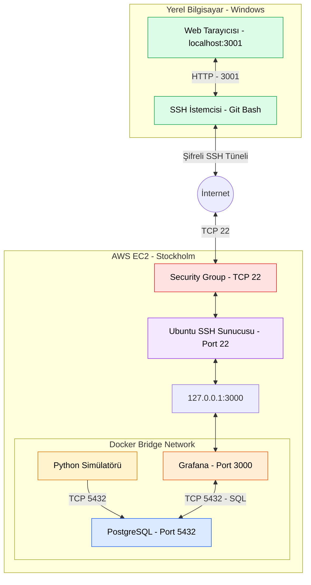

# Ağ Topolojisi

## Ağ Topolojisi Açıklaması

AWS EC2 sunucusuna SSH protokolü üzerinden erişilmektedir.
AWS Security Group üzerinde TCP 22 portuna yalnızca
yetkilendirilen kullanıcı IP adresinden erişim sağlanmaktadır.

Docker Compose tarafından oluşturulan bridge ağı sayesinde
Python, PostgreSQL ve Grafana konteynerleri birbirleriyle
haberleşebilmektedir.

Python simülatörü ve Grafana, PostgreSQL veritabanına
Docker ağı üzerinden 5432 portu ile bağlanmaktadır.

Grafana'nın 3000 portu ve PostgreSQL'in sunucu üzerindeki
5433 portu yalnızca 127.0.0.1 adresine bağlanmıştır.
Bu servisler doğrudan internete açılmamıştır.

Kullanıcı, SSH tüneli aracılığıyla kendi bilgisayarındaki
3001 portunu AWS sunucusundaki 3000 portuna yönlendirerek
Grafana izleme paneline erişmektedir.

## Kullanılan Portlar

| Port | Kullanım amacı | Erişim |
|---|---|---|
| 22 | SSH bağlantısı | Yetkilendirilmiş IP |
| 3000 | Grafana | Sunucu localhost ve Docker ağı |
| 3001 | Grafana SSH tüneli | Kullanıcı bilgisayarı |
| 5432 | PostgreSQL | Docker ağı |
| 5433 | PostgreSQL port yönlendirmesi | Sunucu localhost |

## Ağ Güvenliği

- SSH anahtarı ile kimlik doğrulama
- IP adresi sınırlandırılmış Security Group
- SSH tüneli ile şifreli veri aktarımı
- PostgreSQL parola koruması
- Grafana kullanıcı doğrulaması
- Veritabanının doğrudan internete açılmaması
- Konteynerler arası özel Docker ağı