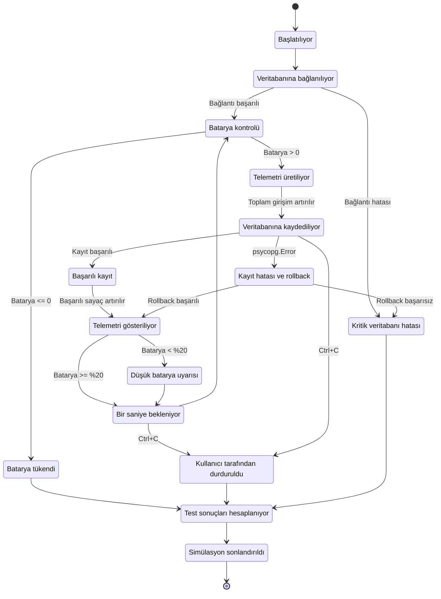

# Simülatör Durum Diyagramı

## Durum Diyagramı (State Diagram)

Bu diyagram, İHA telemetri simülatörünün çalışma sırasında
bulunduğu durumları ve durumlar arasındaki geçişleri
göstermektedir.

## Sistem Durumlarının Açıklanması

| Durum | Açıklama |
|---|---|
| Başlatılıyor | Başlangıç değerleri, performans sayaçları ve test başlangıç zamanı belirlenir. |
| Veritabanına bağlanılıyor | PostgreSQL bağlantısı oluşturulur. |
| Batarya kontrolü | Simülasyonun devam edip etmeyeceği belirlenir. |
| Telemetri üretiliyor | GPS, hız, irtifa, batarya ve zaman bilgileri oluşturulur. |
| Veritabanına kaydediliyor | Toplam girişim sayısı artırılır ve INSERT işlemi gerçekleştirilir. |
| Başarılı kayıt | Başarılı kayıt sayacı bir artırılır. |
| Kayıt hatası | Başarısız kayıt sayacı artırılır ve rollback işlemi uygulanır. |
| Telemetri gösteriliyor | Üretilen telemetri bilgileri terminalde gösterilir. |
| Düşük batarya uyarısı | Batarya seviyesi %20'nin altına düştüğünde uyarı verilir. |
| Bekleme | Bir saniye beklenerek sonraki döngüye geçilir. |
| Kullanıcı tarafından durduruldu | Ctrl+C ile simülasyon sonlandırılır. |
| Kritik veritabanı hatası | Bağlantı veya kurtarılamayan işlem hatası nedeniyle çalışma durur. |
| Batarya tükendi | Batarya sıfıra ulaştığında normal çalışma sona erer. |
| Test sonuçları | Süre, kayıt sayıları, başarı oranı ve hata oranı hesaplanır. |
| Sonlandırıldı | Programın çalışması tamamlanır. |

## Hata Yönetimi

Telemetri kaydı sırasında oluşan PostgreSQL hataları
psycopg.Error kullanılarak yakalanmaktadır.

Başarısız kayıt sayacı artırılır ve rollback işlemi
uygulanır. Rollback başarılı olduğunda simülatör
sonraki telemetri verilerini üretmeye devam edebilir.

Veritabanı bağlantı hatası veya kurtarılamayan bir
işlem hatası oluştuğunda hata üst seviyeye iletilir
ve simülasyon sonlandırılır.

Programın finally bloğunda deneysel test sonuçları
hesaplanarak terminalde gösterilir.

## Sonlandırma Koşulları

Sistem aşağıdaki durumlarda sonlandırılabilir:

- Bataryanın tamamen tükenmesi.
- Kullanıcının Ctrl+C ile simülasyonu durdurması.
- Kritik veritabanı bağlantı veya işlem hatası.

## Performans Ölçümü

Simülasyon sonunda aşağıdaki ölçümler elde edilir:

- Toplam kayıt girişimi
- Başarılı kayıt sayısı
- Başarısız kayıt sayısı
- Sonucu belirsiz girişim sayısı
- Toplam çalışma süresi
- Başarı oranı
- Hata oranı

Sonucu belirsiz girişim sayısı, toplam girişim
sayısından başarılı ve başarısız kayıt sayılarının
çıkarılmasıyla hesaplanır.

## Diyagramın Kapsamı

Durum diyagramı simulator/main.py dosyasındaki
güncel çalışma mantığı temel alınarak hazırlanmıştır.

Ctrl+C kesintisi farklı çalışma aşamalarında da
oluşabilir. Diyagramın okunabilirliğini korumak
amacıyla bu geçişler kayıt ve bekleme durumları
üzerinden örneklendirilmiştir.

Kritik veritabanı hatalarında test sonuçları
finally bloğunda gösterildikten sonra hata
yeniden yükseltilerek program sonlandırılır.

Sistemde otomatik yeniden bağlanma mekanizması
bulunmamaktadır.
