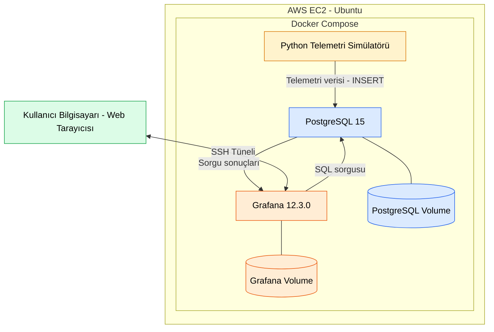

# Sistem Mimarisi

## Mimari Açıklaması

Sistem, AWS EC2 sanal sunucusu üzerinde Docker Compose
kullanılarak çalıştırılan üç temel konteynerden oluşmaktadır.

Python simülatörü tarafından üretilen GPS, hız, irtifa ve
batarya verileri PostgreSQL veritabanına kaydedilmektedir.

Grafana, PostgreSQL veritabanından SQL sorguları ile aldığı
verileri kullanıcıya görsel olarak sunmaktadır.

Docker volume alanları verilerin kalıcılığını sağlamaktadır.

Kullanıcı, Grafana izleme paneline SSH tüneli üzerinden
erişmektedir.